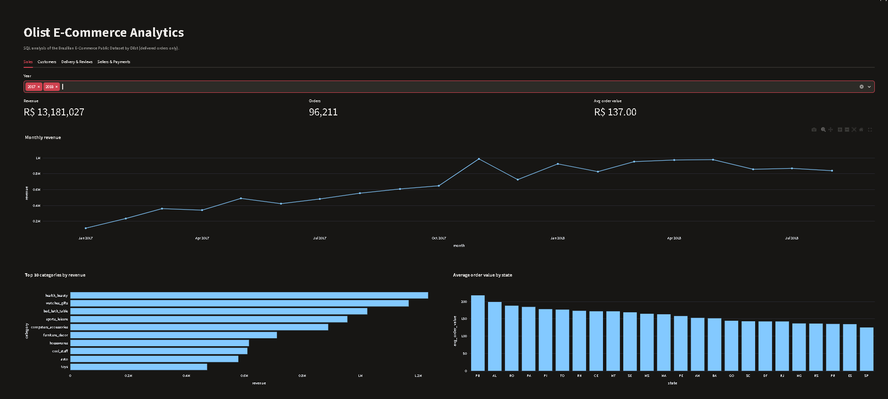

# Olist E-Commerce SQL Analytics

SQL analysis of ~100K orders from the [Brazilian E-Commerce Public Dataset by Olist](https://www.kaggle.com/datasets/olistbr/brazilian-ecommerce) with an interactive Streamlit dashboard.



## Questions answered (12 SQL queries in `sql/`)
Sales growth, top categories, order value by state, repeat-purchase rate, top customers,
delivery time, late-delivery share, impact of lateness on reviews, top and worst sellers,
payment methods, and shipping cost vs price. Techniques: joins, CTEs, window functions
(`LAG`, `RANK`), conditional aggregation, `HAVING`.

## Key findings
## Key findings
Analysis covers delivered orders; the monthly trend uses Jan 2017 – Aug 2018 because other months have too little data.

- **Late delivery hurts reviews.** 8.1% of delivered orders (7,826 of 96,470) arrived after the estimated date. Late orders average a review score of 2.57 versus 4.29 for on-time orders.
- **Retention is very low.** Only 3.0% of customers (2,801 of 93,358) placed a second order, so most revenue comes from one-time buyers.
- **Credit cards dominate payments.** 76.9% of orders are paid by credit card with 3.5 installments on average, while boleto (19.9%) is almost always paid in one installment.
- **Top categories.** health_beauty leads revenue at about R$1.23M, followed by watches_gifts and bed_bath_table.
- **Shipping is expensive for cheap items.** Freight is about 30% of item price for food_drink (29.7%) and electronics (29.1%).
- **Remote states wait longest.** Amazonas averages 26.4 days for delivery, the slowest of the states analysed.
- **Fast early growth.** Monthly revenue rose from about R$112K in Jan 2017 to about R$489K in May 2017, but from a small base, so it should not be read as steady growth.

## Run it
```bash
pip install -r requirements.txt
# download the CSVs from Kaggle into ./data
python load_data.py       # builds olist.db (SQLite)
python run_queries.py     # runs sql/*.sql -> results/*.csv
streamlit run app.py
```

## Tech
Python · SQL (SQLite) · Pandas · Streamlit · Plotly
